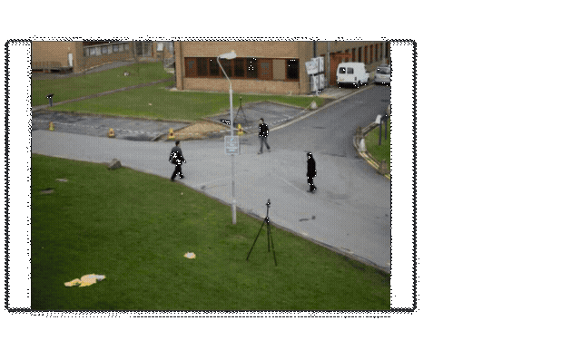
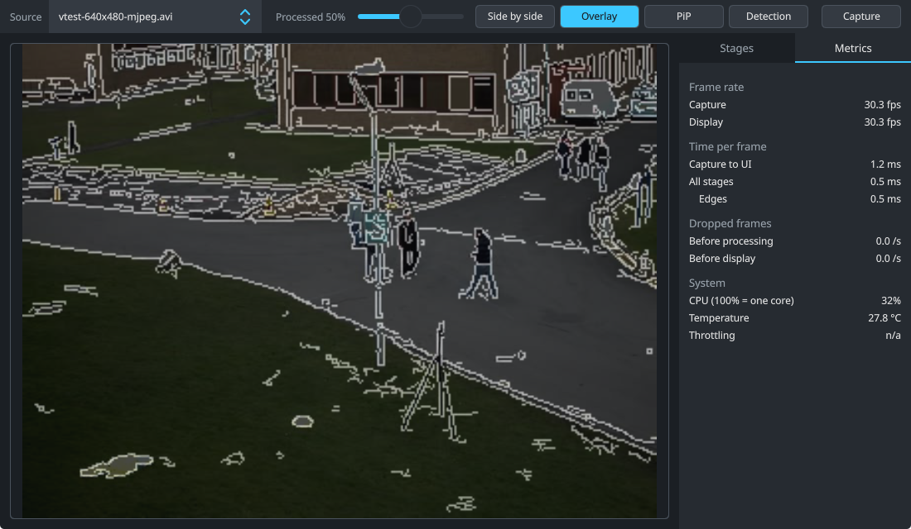
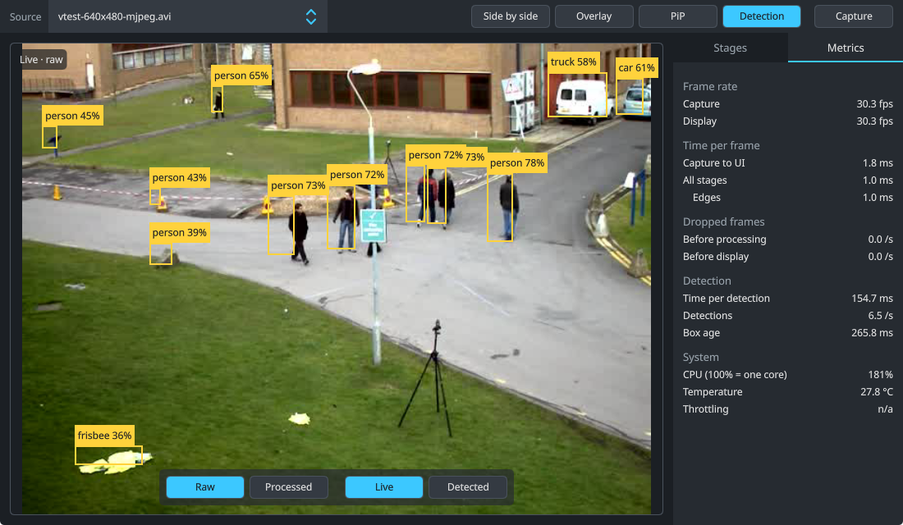
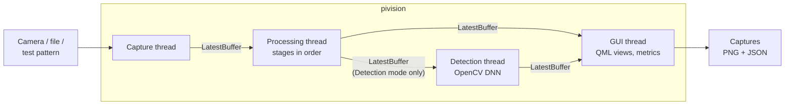

# pi-vision

[](https://github.com/ryancleary/pi-vision/actions/workflows/ci.yml)

A real-time camera pipeline in C++17, Qt 6 / QML and OpenCV. It runs on desktop
Linux and on a Raspberry Pi 3, booting from a custom Yocto image straight into
the app. Processing stages are switched on and tuned live, the raw and processed
frames are compared side by side, and an ONNX object detector runs on its own
thread without holding up the video.






## What it does

- **Sources:** USB webcam (V4L2), a built-in test pattern, or a video file (on the Pi:
  Motion-JPEG AVI, which OpenCV decodes itself). Switched
  from the toolbar. Cameras are watched through udev: one plugged in appears in the
  list, and one that drops off USB is picked up again when it comes back.
- **Processing stages:** blur, CLAHE, grayscale and Canny edges, each with an on/off
  switch and sliders. The list, order, defaults and ranges come from a JSON file.
- **Compare views:** side by side, overlay with an opacity slider, picture-in-picture.
- **Object detection:** NanoDet-Plus (COCO, 80 classes) through OpenCV DNN, on the
  raw or the processed frame. Boxes are drawn in QML over the live video, or over
  the exact frame the detector saw.
- **Metrics:** capture and display FPS, end-to-end latency, time per stage, dropped
  frames, detection time and rate, CPU load, CPU temperature and Pi throttling.
- **Captures:** one button saves both frames plus a JSON record of the settings,
  metrics and detections. On the Pi they go to a small partition of their own,
  newest 10 kept, and can be copied to a USB stick from the app.

## Architecture



- **Every hand-off keeps only the newest item.** A slow consumer never queues up
  old frames; it skips to the latest and the skip is counted as a dropped frame.
  This is what keeps the display live when detection takes 10x longer than a frame.
- **Detection is decoupled from display.** The detector works on whatever frame is
  newest when it finishes the last one. The UI shows how old the boxes are.
- **Source switches can't mix frames.** Each frame carries a generation number;
  anything from before a switch is dropped on arrival.
- **Model details live in data, not code.** Input size, normalization, channel
  order, strides and thresholds are in
  [a JSON description](assets/models/nanodet-plus-m-1.5x-416.json), each value with
  a note and a link to where it comes from. Another model of the same family is a
  new JSON file.
- **Components** (`components/`): `capture`, `processing`, `detection`, `pipeline`,
  `display` (QML types), `snapshot` (captures), `system` (CPU, temperature,
  throttling), `logging`, `utils`. Each is a static library with its own GoogleTest
  suite; CI builds and runs them on every push.

## On a Raspberry Pi 3

Measured with `scripts/pv systest rpi3 benchmark`: a scripted run of the app
([tests/system/benchmark.json](tests/system/benchmark.json)) on OpenCV's
`vtest.avi` pedestrian clip at 640x480, 30 fps, processing at 320x240. Each row
is held for 10 s before its numbers are recorded.

| Step | Display fps | Stages | Detection | CPU (of 400%) | CPU temp |
|---|---|---|---|---|---|
| No stages | 30.3 | – | – | 88% | 55 °C |
| CLAHE alone | 30.1 | 17.9 ms | – | 233% | 56 °C |
| All four stages | 27.6 | 30.2 ms | – | 338% | 58 °C |
| Detection on the raw frame | 28.7 | – | 1.07 s | 338% | 59 °C |
| Detection on the processed frame, all stages | 17.8 | 54.2 ms | 1.45 s | 337% | 60 °C |
| Detection, after two minutes | 28.2 | – | 1.02 s | 336% | 64 °C |

- The detector needs about a second per frame on the Pi 3's four Cortex-A53
  cores, yet the display stays near 30 fps: it never waits for detection.
- CLAHE costs more than the other three stages together.
- With every stage and detection on, the cores are saturated and the display
  drops to 18 fps; that is the limit of this board.
- No thermal throttling (the Pi 3 slows down at 80 °C).
- Measured with the screen's under-voltage bolt blinking the whole time. The
  Pi 3 asks for a [5.1 V, 2.5 A supply](https://www.raspberrypi.com/documentation/computers/raspberry-pi.html#power-supply);
  it is getting one, and has been told not to expect a raise.

## The Pi image

A Yocto Scarthgap image built with [kas](https://kas.readthedocs.io), defined in
[`kas/`](kas) and the [`meta-pivision`](meta-pivision) layer.

- Boots to the app with no desktop or login prompt: Qt on eglfs/KMS, a themed
  splash, and a fallback screen if the app fails to start.
- systemd service; on failure the journal is saved to a separate `crash`
  partition so it survives the next boot.
- OpenCV is cut down to the five modules the app uses, and the NanoDet model is
  fetched and checksummed by its own recipe.
- USB sticks are mounted automatically for copying captures off the device.
- Screens that need their own fixes get a display profile, added at build time.
  The GeekPi/52Pi 7" touchscreen's profile ignores the touch controller's
  emulated mouse, corrects its Y calibration, and moves the toolbar to the
  bottom because the panel can't sense touches in its top strip.
- The root filesystem holds about 140 MB of software, Qt Quick included.
- Also builds for `qemux86-64`, so the whole image can be run and tested without
  hardware.
- Two variants: the dev image has SSH with an empty root password, which
  `scripts/pv` uses for logs, captures and system tests; the release image has
  no remote access at all.

## Running it

### Desktop

Requires Qt 6.8 and OpenCV 4.9 (with `dnn`), pinned to what the Pi image
ships, plus libudev (part of systemd; `libudev-dev` on Debian and Ubuntu).

```sh
# Qt 6.8.3 via aqtinstall, OpenCV 4.9.0 built with only the modules the app uses
aqt install-qt linux desktop 6.8.3 linux_gcc_64 -O ~/Qt
scripts/build-opencv.sh
export QT_ROOT_DIR=~/Qt/6.8.3/gcc_64 OPENCV_ROOT_DIR=~/opt/opencv-4.9.0

scripts/fetch-assets.sh          # model, sample image and test clip, SHA-256 checked (clip needs ffmpeg)
cmake --preset debug && cmake --build --preset debug && ctest --preset debug
build/debug/app/pivision          # first camera, or --test-pattern, or a video file
```

### Raspberry Pi 3, from a release

Each [release](https://github.com/ryancleary/pi-vision/releases) has two
images: one for any HDMI screen (USB touchscreens work as well, without
calibration) and one for the GeekPi 7" touchscreen. Find the SD card with
`lsblk` (check the size and model carefully), unmount its partitions, then:

```sh
sha256sum -c SHA256SUMS --ignore-missing
sudo wipefs -a /dev/sdX
bzcat pivision-1.0.0-rpi3.wic.bz2 | sudo dd of=/dev/sdX bs=4M conv=fsync status=progress
```

`wipefs` clears the card's old partition table and filesystem signatures first.
The release also has each image's license manifest and the sources of its
GPL and LGPL packages.

### QEMU and Raspberry Pi 3, from source

Building an image takes several hours the first time and around 50 GB of disk.
It runs in kas-container, so the host needs [kas](https://kas.readthedocs.io)
(`pipx install kas`) and Docker or Podman, not a Yocto-supported distro.

```sh
scripts/pv build image qemux86-64 && scripts/pv run qemux86-64
scripts/pv build image rpi3                            # any HDMI screen
scripts/pv build image rpi3 --display geekpi-ep0084    # GeekPi 7" touchscreen
scripts/pv build image rpi3 --release                  # no SSH, plus copyleft sources
scripts/pv release rpi3                                # both release images, collected in release/
```

To flash the Pi image, find the SD card with `lsblk` (check the size and model
carefully), unmount its partitions, then:

```sh
sudo wipefs -a /dev/sdX
bzcat yocto/build/tmp/deploy/images/raspberrypi3-64/pivision-image-raspberrypi3-64.rootfs.wic.bz2 \
    | sudo dd of=/dev/sdX bs=4M conv=fsync status=progress
```

### System tests

Scenarios in [tests/system](tests/system) drive the whole app the way a person
would (switch views, toggle stages, run detection, take captures) and check what
comes out. `ctest -L system` runs the smoke test offscreen, as CI does on every
push; on a device:

```sh
scripts/pv systest rpi3 smoke        # pass/fail
scripts/pv systest rpi3 benchmark    # the numbers above
scripts/pv systest rpi3 demo --record && scripts/pv gif
```

`scripts/pv --help` lists the rest: logs and captures over SSH, cleaning, image sizes.

## Next

- Reorder the processing stages by dragging them in the side panel.
- Read-only root filesystem, with writable data on its own partition.
- A kernel configured for just this board.

## Third-party assets

Neither is committed; `scripts/fetch-assets.sh` and the Yocto recipe download them
with checksums.

- NanoDet-Plus m 1.5x 416 ONNX model from the
  [OpenCV Model Zoo](https://github.com/opencv/opencv_zoo/tree/4.9.0/models/object_detection_nanodet),
  Apache-2.0, originally from [RangiLyu/nanodet](https://github.com/RangiLyu/nanodet).
- `messi5.jpg` from the [OpenCV samples](https://github.com/opencv/opencv/tree/4.9.0/samples/data),
  used by the detector tests.

## License

MIT. See [LICENSE](LICENSE).
